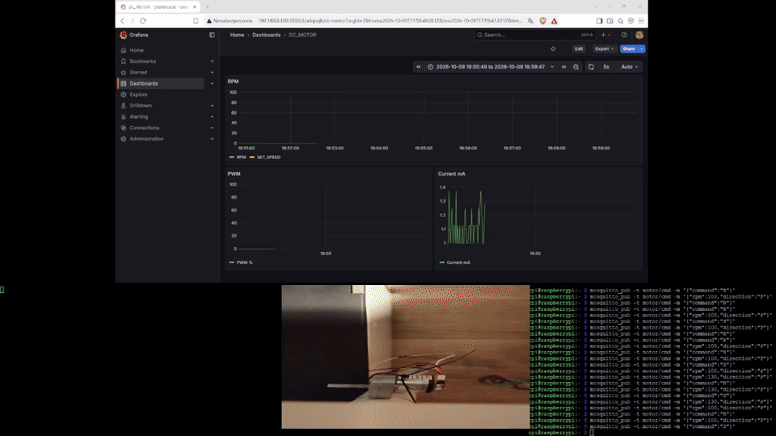

## Demo

# stm32-distributed-motor-control
Distributed embedded motor control system: STM32L476 Motor ECU in a
closed feedback loop with a Raspberry Pi supervisor over UART. The Pi
issues speed commands and receives live telemetry (current, RPM, PWM,
setpoint) in real time, visualized in Grafana.

## Final Architecture

* STM32L476 Motor ECU — closed-loop speed control, diagnostics, telemetry
* DC Motor with Quadrature Encoder
* DRV8876 Motor Driver (PH/EN mode, current sense, hardware fault output)
* Raspberry Pi Supervisor — sends commands, receives telemetry, feeds Grafana
* UART — bidirectional command & telemetry link between Pi and STM32L476
* Grafana — live visualization of current, RPM, PWM, and setpoint

> CAN bus and a second STM32 node (originally planned as a
> Pi -> CAN -> STM32L476 relay) were explored as a learning goal for
> this project but ultimately moved to a dedicated follow-up project
> focused specifically on CAN. This system reaches the same end
> goal — a distributed, closed-loop motor controller supervised by a
> Raspberry Pi — over UART instead.

## Development Roadmap

* [x] Motor PWM
* [x] UART Control
* [x] Current Measurement (DRV8876 IPROPI)
* [x] Encoder (quadrature, closed-loop RPM feedback)
* [x] Raspberry Pi Supervisor (bidirectional UART: commands + telemetry)
* [x] Grafana (live visualization)
* [x] PI Controller (speed closed loop)
* [x] Diagnostics (stall / encoder fault / tracking error / driver overcurrent)
* [ ] CAN bus, second STM32 node — planned for a follow-up project

Motor parameters — setpoint, measured speed, current, PWM duty — are
streamed over UART as JSON and visualized live in Grafana.

📄 For the full firmware functionality breakdown (UART commands, encoder details, PI tuning, current sense configuration, diagnostics fault table) see [`firmware/README.md`](firmware/README.md).

🔧 For the hardware schematic and board details see [`hardware/README.md`](hardware/README.md).
